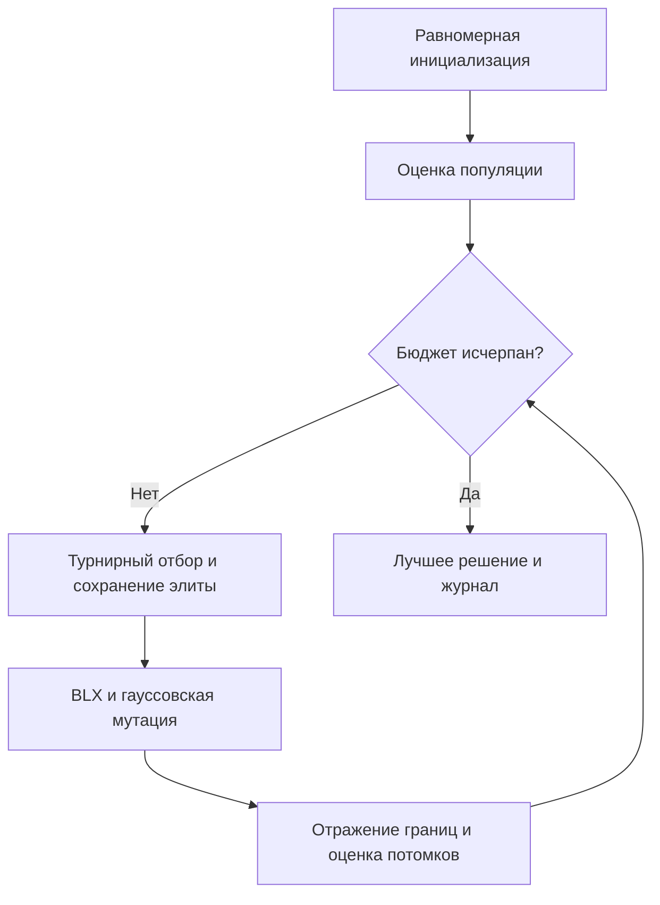
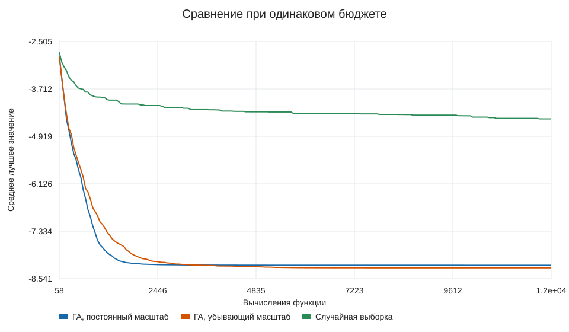
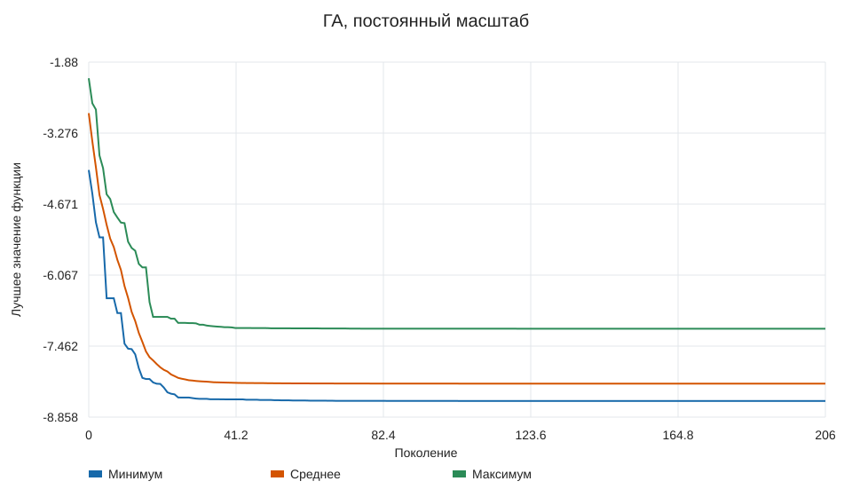
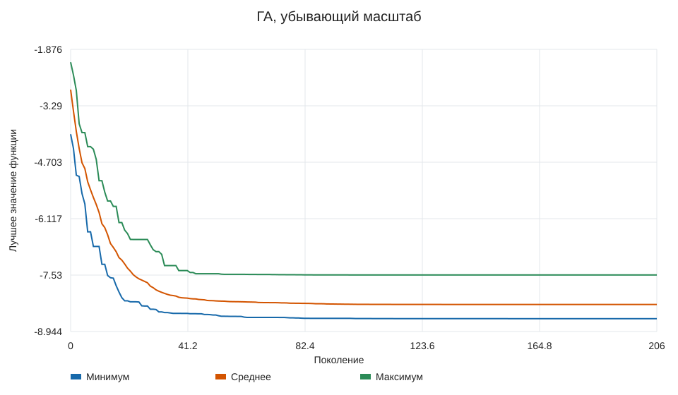
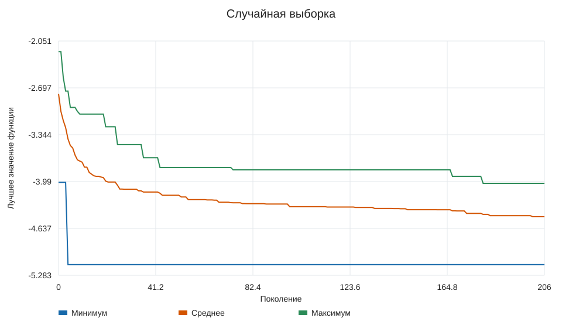

# Лабораторная работа № 1

## Постановка и индивидуальный вариант

N = 28, группа 517, Q = 1, Y = 26, V = 10. Размерность d = 5 + (10 mod 6) = 9.
Минимизируется функция Михалевича:

$$f(x) = -\sum_{i=1}^9 \sin(x_i)\,[\sin(i x_i^2 / \pi)]^{20},\qquad 0\le x_i\le\pi.$$

Функция разделима по координатам, но содержит узкие долины и множество локальных
минимумов. Случайной выборке трудно одновременно попасть в хорошие долины девяти
координат. Локальный поиск зависит от начальной точки. Разделимость также означает,
что для этой конкретной функции существуют более подходящие методы, чем общий ГА.

Определение, область и параметр m = 10 сверены с
[каталогом Университета Саймона Фрейзера](https://www.sfu.ca/~ssurjano/michal.html).
В [научной публикации](https://pmc.ncbi.nlm.nih.gov/articles/PMC4772519/)
приведены ориентиры: d = 2 — −1,8013; d = 5 — −4,687658;
d = 10 — −9,66015. Эти значения относятся к другим размерностям,
поэтому непосредственно сравнивать с ними девятимерный результат нельзя.
Численный ориентир для d = 9 отдельно вычислен покоординатным просмотром
20000 интервалов и уточнением золотым сечением:
**f ≈ -8.6601517156**. Координаты в `results/reference.json`.
Это независимый численный ориентир, не строгая гарантия; общий нижний предел f ≥ −9
следует из границ каждого слагаемого. ГА не получает координаты ориентира.

## Представление и алгоритм

Генотип и фенотип совпадают: список из девяти вещественных чисел.
Инициализация равномерная в допустимом кубе. Турнир из трёх особей выбирает родителей.
BLX-α с α = 0.15 создаёт каждую координату из расширенного интервала
между родителями. Он учитывает вещественное представление и допускает исследование
соседней области. Гауссовская мутация выполняется независимо по координатам.
Выход за границы исправляется отражением, включая большие скачки.
Две элитные особи переносятся без повторной оценки. Остановка точно по бюджету,
включая при необходимости неполное последнее поколение.

## Параметры и сравнение

Популяция 60; бюджет 12000 вычислений на запуск;
вероятность скрещивания 0.9; вероятность мутации одной
координаты 1/9; элитизм 2; начальные состояния генератора
1000–1019.
Полные параметры в `config.json`, фактически применённые — в `results/environment.json`.

Две конфигурации ГА различаются **только законом масштаба мутации**:
постоянный σ = 0.03π и убывающий
σ(t) = π·(0.001 +
(0.12-0.001)(1−t)²),
где t — доля израсходованного бюджета.
Убывающий масштаб является дополнительным заданием; он задаётся заранее,
не зависит от качества популяции и не является самоадаптацией.
Случайная выборка имеет тот же бюджет. Оценки начальной популяции включены.
Оценки элиты повторно не считаются. Отдельное вычисление ориентира исключено.

## Результаты

Для каждого метода выполнено 20 независимых запусков.
Стандартное отклонение выборочное (делитель n−1). Меньшее значение лучше.

| Метод | Лучшее | Среднее | Медиана | Станд. откл. | Худшее |
|---|---:|---:|---:|---:|---:|
| ГА, постоянный масштаб | -8.5406 | -8.19945 | -8.28612 | 0.376372 | -7.11997 |
| ГА, убывающий масштаб | -8.62254 | -8.26661 | -8.31873 | 0.258207 | -7.52679 |
| Случайная выборка | -5.13625 | -4.4744 | -4.49204 | 0.312257 | -4.01418 |

Средняя парная разность «убывающий − постоянный» при совпадающих начальных
состояниях генератора: -0.0671554.
После различий в операторах траектории случайных чисел могут расходиться.
CSV содержит также время и отклонение от ориентира. Координаты лучшего решения и
его начальное состояние генератора записаны в `results/best.json`.

## Выводы

Убывающий масштаб улучшил среднее значение относительно постоянного. Это вывод о заданном бюджете и выбранных параметрах, а не универсальная
гарантия. Лучший результат ГА имеет отклонение от численного ориентира
0.0376162.
Среднее значение лучшей конфигурации равно -8.26661,
случайной выборки — -4.4744.
Результат следует оценивать и по отклонению от ориентира, и по разбросу серии.
Даже при выигрыше у случайной выборки отсутствие строгого сертификата не позволяет
объявить найденную точку доказанным глобальным минимумом.
