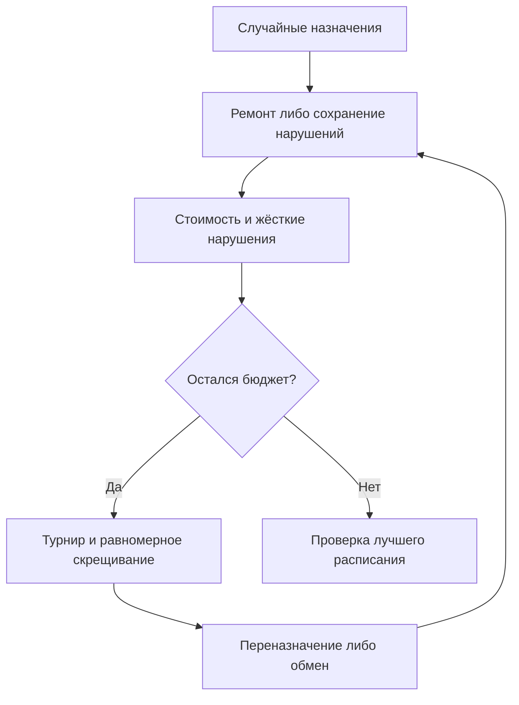
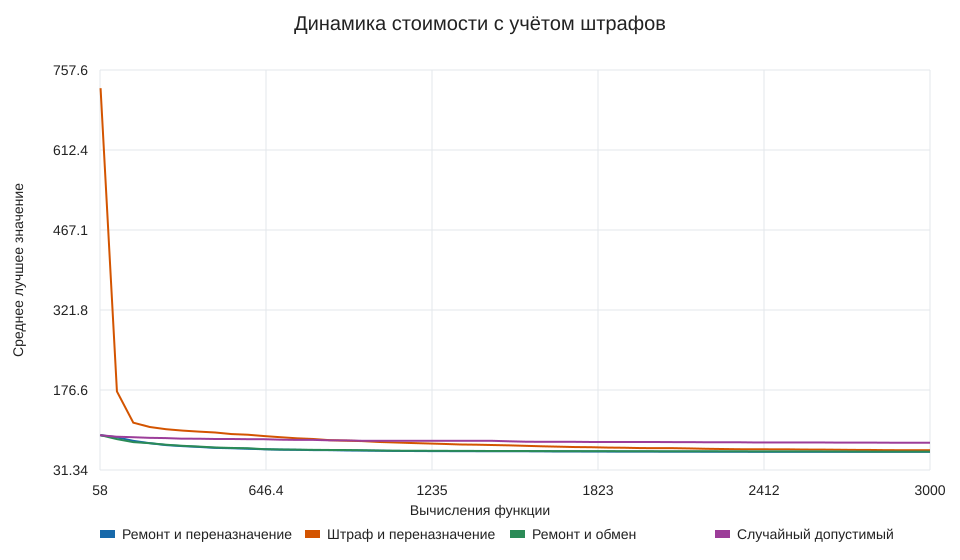
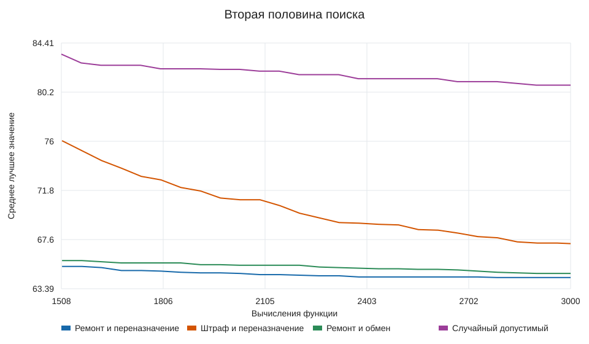

# Лабораторная работа № 2

## Постановка и данные

Индивидуальный вариант 10: план дежурств на неделю, N = 28, группа 517.
Назначаются восемь сотрудников на 21 смену (по три в каждый из семи дней).
В каждой смене ровно один сотрудник; сотрудники 1–4 имеют право на ночные смены.
Все смены одинаковой длительности, отдых после ночной смены запрещает только
утреннюю смену следующего дня. Неделя рассматривается отдельно: переход к следующему
понедельнику не моделируется. Это явные допущения учебного экземпляра.

Входной файл `data.json` с начальным состоянием генерации 260010 содержит
доступность, цены нежелательности назначений и 27 конфликтующих пар.
Данные синтетические: сначала задаётся допустимый свидетель; затем с вероятностью
0,17 запрещаются прочие назначения, стоимости независимо выбираются от 1 до 10.
Свидетель не является оптимумом и не добавляется в исходную популяцию.
Он используется для проверки входных данных и аварийного восстановления после
5000 узлов поиска. Число таких случаев фиксируется отдельно.
Ресурсов восемь, событий 21, конфликтов 27: минимальный масштаб задания соблюдён.

## Формальная модель

Генотип и фенотип — вектор a длины 21, aᵢ ∈ {0,…,7}. Позиция задаёт смену,
значение — сотрудника. Каждая позиция всегда содержит ровно одно назначение.
Жёсткие условия: доступность, допуск к ночной смене, не более одной смены в день,
отдых после ночи, не более четырёх смен на сотрудника в неделю.

Мягкая стоимость:

$$C(a)=\sum_i c_{i,a_i} + 2\sum_{e=0}^7 |n_e-3|.$$

Здесь c — нежелательность назначения, n — недельная загрузка. Желаемые три смены
для каждого недостижимы одновременно (всего 21, а не 24), поэтому дисбаланс не может
обнулиться; минимальный вклад дисбаланса равен шести. Минимизируется C среди
допустимых решений. Для штрафного метода F = C + 1000·H,
где H — число нарушений, превышение недельного лимита считается по каждой лишней смене.
Для корректных векторов C ≤ 300, поэтому любое допустимое решение лучше недопустимого
при указанном штрафе. Ошибки формата отвергаются до вычисления мягкой стоимости.

## Алгоритм и операторы

Турнир из трёх особей, равномерное скрещивание векторов назначений, элитизм двух
особей. Сравниваются переназначение сотрудника из разрешённого для смены множества
и обмен значений двух позиций. Обмен сохраняет недельные количества, но может
нарушить доступность или отдых. Скрещивание тоже может создавать конфликты.

Ремонт решает только задачу допустимости: сначала назначается наиболее ограниченная
смена; варианты упорядочены по сохранению гена, загрузке и стоимости; при тупике
выполняется возврат. Оптимальное расписание этим поиском не вычисляется.
Штрафный метод сохраняет нарушения и оценивает их явно.

## Эксперимент

По 20 запусков каждого метода; начальные состояния
2000–2019; популяция 60;
бюджет 3000 оценок; вероятность скрещивания 0.9;
вероятность изменения каждой позиции 0.08.
Переназначение может выбрать того же сотрудника; обмен может выбрать ту же позицию.

Штраф и ремонт сравниваются при одинаковом операторе переназначения.
Две мутации сравниваются при одинаковом ремонте. Случайный допустимый поиск
использует такое же восстановление и тот же бюджет оценок стоимости.
Детерминированная жадная эвристика дополнительно даёт C = 73
за одно построение; её бюджет меньше, это дополнительный ориентир.
Бюджет равен по оценкам, но ремонт требует дополнительного времени; время каждого
запуска приведено в CSV и не скрывается.

## Результаты

Статистика мягкой стоимости только по допустимым финальным решениям:

| Метод | Лучшее | Среднее | Медиана | Станд. откл. | Худшее |
|---|---:|---:|---:|---:|---:|
| Ремонт и переназначение | 64 | 64.35 | 64 | 0.48936 | 65 |
| Штраф и переназначение | 65 | 67.25 | 67 | 1.94327 | 72 |
| Ремонт и обмен | 64 | 64.7 | 65 | 0.801315 | 67 |
| Случайный допустимый | 73 | 80.8 | 81 | 3.8879 | 87 |

Доля допустимых финальных решений и возвраты к свидетелю:

- Ремонт и переназначение: 100%; аварийных возвратов к свидетелю 0.
- Штраф и переназначение: 100%; аварийных возвратов к свидетелю 0.
- Ремонт и обмен: 100%; аварийных возвратов к свидетелю 0.
- Случайный допустимый: 100%; аварийных возвратов к свидетелю 0.

Графики отдельных серий с минимумом, средним и максимумом находятся в `results/`.
Штрафные значения не следует смешивать с мягкими стоимостями допустимых решений.
Полные нарушения и стоимости сохранены в `runs.csv`.

## Лучшее расписание

Метод «Ремонт и переназначение», начальное состояние генератора 2001,
мягкая стоимость 64; жёстких нарушений **0**.

| День | Утро | День | Ночь |
|---|---|---|---|
| Понедельник | Сотрудник 7 | Сотрудник 5 | Сотрудник 1 |
| Вторник | Сотрудник 4 | Сотрудник 6 | Сотрудник 2 |
| Среда | Сотрудник 6 | Сотрудник 7 | Сотрудник 3 |
| Четверг | Сотрудник 4 | Сотрудник 6 | Сотрудник 2 |
| Пятница | Сотрудник 7 | Сотрудник 4 | Сотрудник 2 |
| Суббота | Сотрудник 3 | Сотрудник 5 | Сотрудник 1 |
| Воскресенье | Сотрудник 5 | Сотрудник 8 | Сотрудник 3 |

Полная предметная таблица находится в `results/best_schedule.csv`.
Два допустимых и два недопустимых вектора приведены в `results/examples.json`.
Первый недопустимый пример нарушает допуск к ночи, второй — одну смену в день.
Причины определяются проверяющей функцией; примеры не подменяют проверку остальных условий.

## Выводы

Переназначение дало меньшее среднее значение.Ремонт гарантирует допустимость после вариации, но может уменьшать
разнообразие, поскольку несколько исходных векторов переходят в одно расписание.
Штрафный поиск допускает промежуточные конфликты; его устойчивость оценивается по
доле допустимых финальных решений и разбросу стоимости.
Результат приемлем как допустимый недельный план с явно измеренной нежелательностью.
Его качество сравнивается с жадным построением (73) и случайным
допустимым поиском; строгая глобальная оптимальность не установлена.

## К защите

1. Дискретная позиция хромосомы непосредственно обозначает смену, декодирование тождественно.
2. Все жёсткие условия централизованы в `violations`; предпочтения относятся к мягкой цели.
3. Ремонт сохраняет допустимость, обмен сам по себе её не гарантирует.
4. Большой штраф отделяет допустимость от цены предпочтений, но не гарантирует её достижение за конечный бюджет.
5. При росте числа смен восстановление становится дороже; уместны локальные обмены цепочками и отдельный учёт времени.
