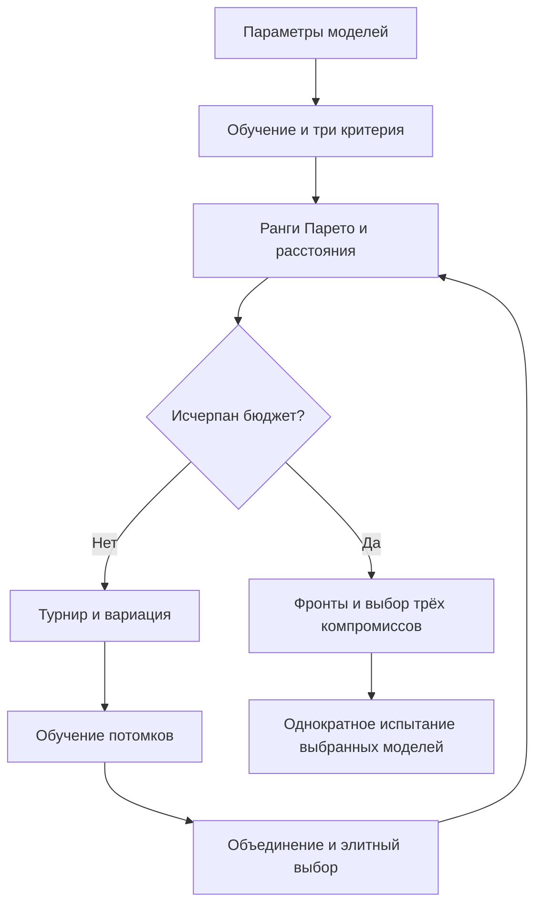
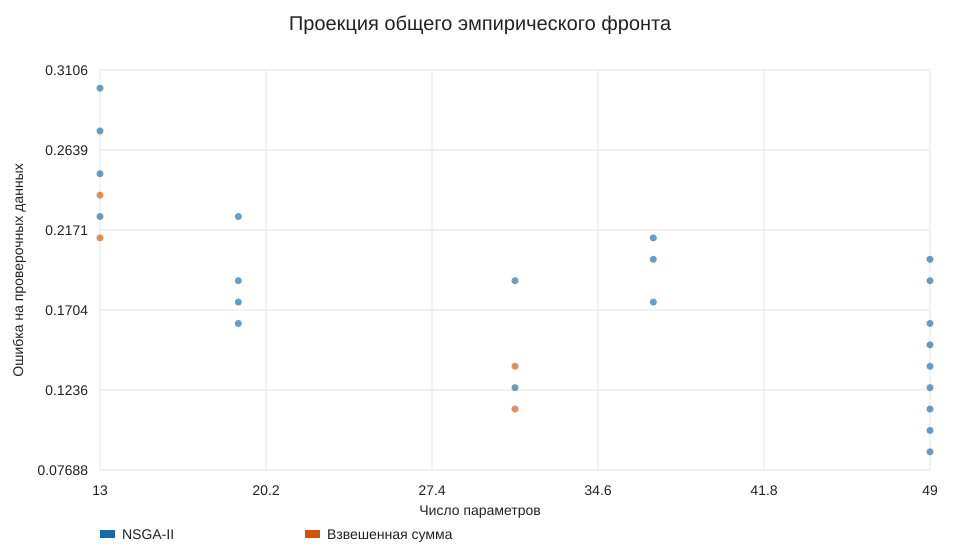
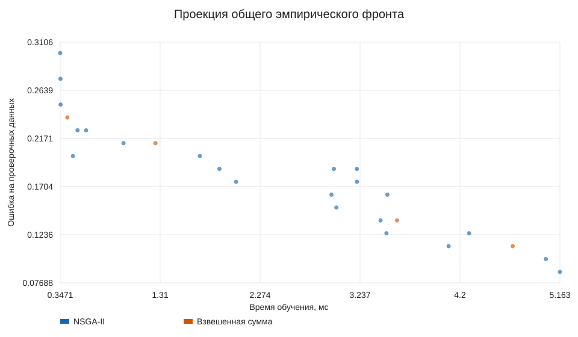
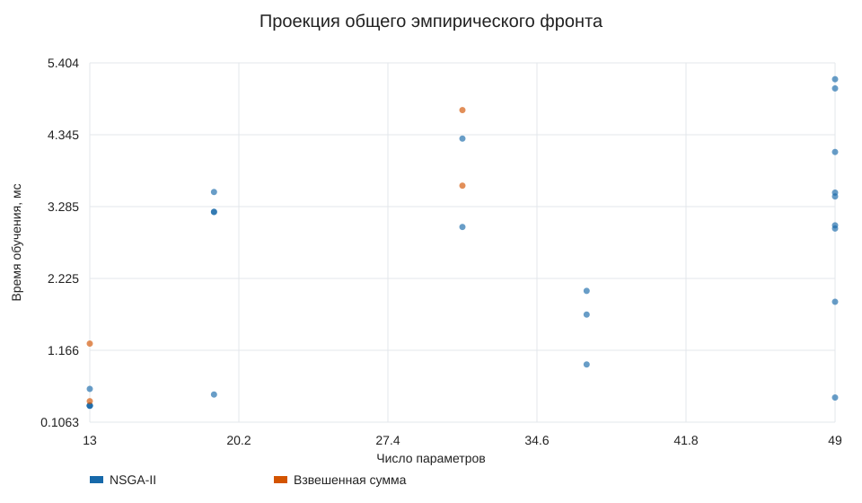

# Лабораторная работа № 3

## Постановка и направление

Вариант 10, направление А: подбор параметров малого классификатора.
N = 28, группа 517, Q = 1, Y = 26. Требуется максимизировать качество и
минимизировать время обучения и число параметров. Выбрано направление А;
в задании отсутствует дополнительное правило выбора между А и Б.

Используется нейронная сеть с четырьмя входами, одним скрытым слоем tanh и одним
логистическим выходом. Оптимизируются число скрытых узлов 2–16,
число эпох 10–80, десятичный логарифм скорости обучения
-2.0–-0.3 и включение L2-регуляризации 0 либо 0,001.
Генотип — смешанный вектор этих четырёх параметров; фенотип — обученная сеть.
Обучение реализовано вручную полным пакетным градиентным спуском по перекрёстной
энтропии. NumPy используется для матричных операций, готовой модели и оптимизатора нет.

## Данные и цели

360 синтетических наблюдений с четырьмя признаками из равномерного распределения
[−2,2]. Метка равна 1 при x₁x₂ + 0,55x₃ − 0,25x₄ + ε > 0,
ε — гауссовский шум с σ = 0,15. Начальное состояние генерации 260310.
Строки 0–199 обучающие, 200–279 проверочные, 280–359 испытательные.
Наблюдения независимы и одинаково распределены; файл `data.csv` включён в репозиторий.
Среднее и масштаб вычисляются только по обучающей части.
Противоречие критериев: более широкая сеть и длительное обучение могут улучшать
разделение нелинейных классов, но увеличивают затраты и число параметров.

Вектор минимизируемых целей:

1. f₁ = 1 − доля правильных ответов на проверочных данных.
2. f₂ = медианное фактически измеренное время обучения в миллисекундах
   по 3 повторным обучениям с одинаковой инициализацией.
3. f₃ = число обучаемых параметров = 6h + 1, включая смещения.

Начальное состояние инициализации весов 261010 одинаково для всех
оценок одной архитектуры, поэтому качество при фиксированных настройках повторяется.
Измерение времени включает создание весов и обучение, исключает подготовку данных
и проверку точности. До опыта выполняется разогрев библиотеки.
Кэширование оценок не применяется. Число обращений к функции и число реальных
обучений указаны отдельно.

## Алгоритм

Самостоятельно реализованы попарное доминирование, недоминируемая сортировка,
нормированное расстояние до скопления, бинарный турнир по рангу и расстоянию,
выбор следующего поколения из объединения родителей и потомков.
Доминирование требует неухудшения всех целей и строгого улучшения хотя бы одной.
Скрещивание равномерное по четырём генам; мутация изменяет ширину, число эпох,
логарифм скорости или переключает регуляризацию; границы восстанавливаются обрезанием.
Новый относительно первых двух работ механизм — сортировка по Парето и сохранение
разнообразия фронта. Описание исходного алгоритма:
[Deb и соавторы, 2002](https://doi.org/10.1109/4235.996017).

## Сравнение и параметры

NSGA-II сравнивается с ГА взвешенной суммы. Операторы, исходные распределения,
популяция 32 и бюджет 320 одинаковы.
Различаются только правила отбора родителей и элитного выбора.
Взвешенная сумма использует нормировки [1.0, 10.0, 97.0] и циклически
назначенные по номеру запуска веса [[0.8, 0.1, 0.1], [0.5, 0.25, 0.25], [0.25, 0.5, 0.25]].
Это анализ трёх предпочтений при суммарных 20 запусках, а не отдельные
серии по 20 для каждого вектора весов; точные веса каждого запуска сохранены в CSV.
Вероятность скрещивания 0.9, вероятность мутации каждого гена
0.3, начальные состояния поиска
3000–3019.

Бюджет каждого метода: 320 оценок и
960 обучений за запуск. Полученные множества
сравниваются по аддитивному ε-индикатору к общему эмпирическому фронту из финальных
популяций обоих методов. Разности критериев делятся на указанные фиксированные масштабы.
ε показывает худшее необходимое ухудшение для покрытия общей опорной выборки,
меньше лучше. Опорная выборка не является известным истинным фронтом.

## Результаты

По 20 независимых запусков двух алгоритмов.
Статистика ε-индикатора:

| Метод | Лучшее | Среднее | Медиана | Станд. откл. | Худшее |
|---|---:|---:|---:|---:|---:|
| NSGA-II | 0.0375 | 0.0604166 | 0.0618557 | 0.0219283 | 0.1125 |
| Взвешенная сумма | 0.125 | 0.177663 | 0.15 | 0.080426 | 0.38594 |

Статистика наименьшей проверочной ошибки в финальной популяции:

| Метод | Лучшее | Среднее | Медиана | Станд. откл. | Худшее |
|---|---:|---:|---:|---:|---:|
| NSGA-II | 0.0875 | 0.11 | 0.10625 | 0.0318301 | 0.2 |
| Взвешенная сумма | 0.0875 | 0.210625 | 0.225 | 0.051343 | 0.2625 |

Общий эмпирический фронт содержит 26 различных настроек.
При объединении одинаковых настроек используется медиана наблюдавшегося времени;
затем снова выполняется недоминируемая сортировка.

## Три компромиссных решения

Настройки выбираются до загрузки испытательных меток. Первое решение минимизирует
проверочную ошибку; второе — число параметров среди оставшихся; третье — сумму
нормированных целей среди оставшихся. Исключение уже выбранных настроек обеспечивает
три различных предметных примера. Все они принадлежат эмпирическому фронту.

| Решение | Скрытых узлов | Эпох | Параметров | Точность проверки | Точность испытания | Время, мс |
|---|---:|---:|---:|---:|---:|---:|
| Наиболее точная | 8 | 73 | 49 | 0.912 | 0.875 | 5.163 |
| Наиболее компактная | 2 | 28 | 13 | 0.787 | 0.675 | 1.265 |
| Сбалансированная | 2 | 11 | 13 | 0.762 | 0.713 | 0.415 |

Наиболее точная модель подходит при приоритете качества; компактная — при ограничении
памяти и вычислений; сбалансированная отражает равноценность нормированных целей.
Обученные веса и нормировка сохранены в `results/model-1.json`–`model-3.json`.
Собственная линейная логистическая модель, обученная 200 эпох со скоростью 0,1,
имеет проверочную точность 0.750 и испытательную 0.688.
Она служит дополнительным ориентиром качества, а не равнобюджетной серией поиска.

## Выводы и ограничения

В этой серии NSGA-II имеет меньший средний ε-индикатор.
Взвешенная сумма зависит от заданных весов и масштаба критериев и может пропускать
участки невыпуклого фронта; NSGA-II сохраняет разные компромиссы без единой свёртки.
Практическую приемлемость каждой модели показывают испытательная точность и её
стоимость, а не только лучший ответ на проверочных данных.

Время обучения зависит от оборудования, нагрузки и реализации матричных операций.
Медиана трёх повторов уменьшает шум, но не устраняет его; при перезапуске с тем же
состоянием генератора сортировка по времени может менять дальнейшую траекторию.
В журнале `evaluations.jsonl` сохранены все времена и настройки, а `replay.py`
воспроизводит исходные решения отбора по записанным критериям без нового измерения.
Проверочное качество и веса при одинаковых параметрах воспроизводятся независимо
от времени. Выводы о превосходстве по скорости ограничены этой средой выполнения.
Опыты последовательны; серии методов могли испытывать разную фоновую нагрузку.
Нормировка времени 10 мс является явно заданной шкалой предпочтений, не верхним пределом.
Для серьёзного сравнения уместны чередование методов и повторение в изолированной среде.

Общая опорная выборка построена из результатов самих алгоритмов; ε оценивает их
взаимное покрытие, не расстояние до истинного глобального фронта. Применение модели
к реальным данным требует отдельной проверки; текущая задача является синтетической.

## К защите

1. Три цели сравниваются по доминированию, а не одному числу.
2. Крайние решения получают большое расстояние до скопления для сохранения диапазона компромиссов.
3. Число параметров включает веса обоих слоёв и все смещения.
4. Повторное использование испытательных меток для выбора настроек исказило бы итоговую оценку.
5. Инициализация модели и случайность поиска разделены; шум времени фиксируется в журнале.
